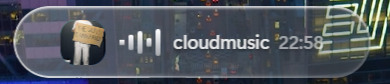
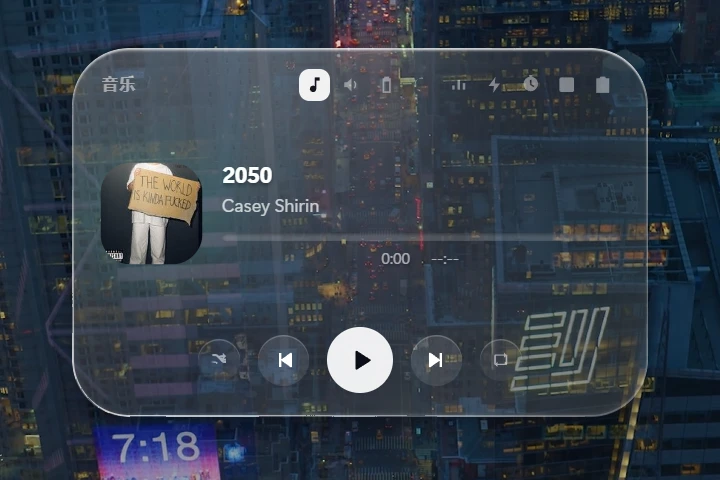
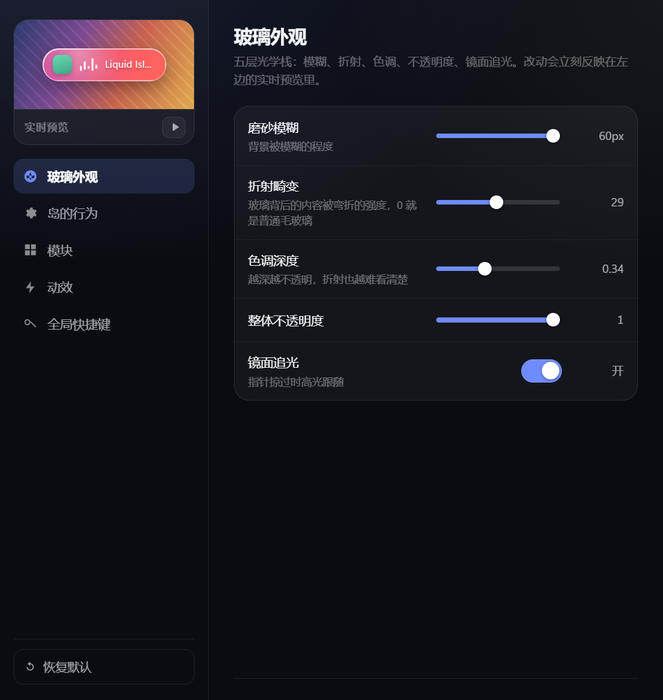

<div align="center">

# Windows Dynamic Island

### The Dynamic Island, finally on Windows — with real glass that actually bends what's behind it

A frameless, always-on-top status island for your screen edge. It reads your media,
volume, battery, network and machine vitals from native Windows APIs, decides what
matters right now with a unit-tested priority engine, and morphs between them with
Apple-Liquid-Glass optics — genuine backdrop refraction, not a blur.

**[Download for Windows](../../releases)** · [How it works](#how-it-works) · [Build from source](#build-from-source)

**English** · [中文](README.zh-CN.md)


</div>

---

## Why this exists

Windows has no place for "what's playing right now" that doesn't cost you a window.
Media keys pop up an overlay and vanish. Taskbar thumbnails hide behind Alt+Tab.
The tray is a graveyard.

This puts a living pill at the top of your screen. Hover it and it grows into a card
you can actually drive. It gets out of the way the rest of the time — clicks pass
straight through to whatever is underneath.

The part that's hard to copy: **the glass bends the desktop behind it.** Chromium 130+
lets `backdrop-filter` take an SVG filter, and `feDisplacementMap` displaces the
*backdrop itself*. So the city lights, the code editor, the video behind the island
are genuinely warped through the lens — the same trick Apple uses, running on Windows.

<p align="center"></p>

---

## Highlights

**Real refraction, not a blur.** Five optical layers — frost, displacement, tint,
opacity, specular tracking. The displacement map is tuned to a lens-like distortion
(`baseFrequency` 0.004/0.006, one octave) rather than noise. Every parameter is live
and previewed as you drag it.

**A state center, not a music widget.** Nine modules share one island and one
priority engine. Music, volume, battery, network, CPU/RAM, quick system actions,
a focus timer, todos and clipboard history. Whichever matters most wins the screen.

**Priority that respects you.** Whatever module you just touched outranks everything
for 10 seconds — otherwise music playing would make the volume card unreachable.
Your current card outranks the default module but never outranks a low-battery or
network-down alert. The whole engine is a pure function with 40 unit tests.

**Click-through without the feedback loop.** The obvious way to do this — listen for
`pointermove` and toggle `setIgnoreMouseEvents` — oscillates forever, because Windows
replays mouse messages the instant the state flips. This polls the cursor from the
main process at 50ms instead. No forwarded events, no loop.

**Two native probes, not scripts.** `probe.exe` reads SMTC media (PowerShell can't —
the WinRT projection won't read `IAsyncOperation<interface>`, so the album art is
unreachable from a script). `sysprobe.exe` reads Core Audio volumes, WinRT battery,
connectivity and machine vitals. Both start an order of magnitude faster than a
scripted equivalent.

**Nothing wasted while idle.** The specular highlight only repaints when a rule
actually reads it. Pointer moves are coalesced into one animation frame. The rect is
cached and invalidated on resize, not re-read per event. The morph has been measured
at p95 3.5ms/frame.

---

## The modules

| | |
|---|---|
| **音乐** | SMTC session — art, title, timeline, transport. Seek by dragging the track. |
| **音量** | Per-device level and mute, ±5 steps, stepless slider. |
| **电池** | Charge, time remaining, low-battery alert. Correctly says "no battery" on desktops. |
| **网络** | Adapter type, SSID, signal. Falls back to a dead-air card when disconnected. |
| **性能** | CPU, RAM, process count. |
| **快捷** | Lock, sleep, screenshot, task manager, restart explorer — two-step confirm on the destructive ones. |
| **专注** | Countdown timer that freezes on pause and resumes where it stopped. |
| **待办** | Quick-add list, persisted next to your settings. |
| **剪贴板** | History with search. Click a row and it pastes straight back into the window you came from. |

---

## Screenshots

**Hover the pill and it grows into a card you can drive.** Transport, timeline, and the
module rail along the top — every module is one click away without leaving the island.

<p align="center"></p>

**Every glass parameter is live.** The settings window renders the actual optical stack
at pill scale, driven by the settings on the right — what you drag is what you get,
before you commit it.

<p align="center"></p>

---

## Install

**Download the latest release** — unzip and run `liquid-island.exe`. No installer,
no admin rights, no runtime to fetch.

> The three probe binaries (`probe.exe`, `sysprobe.exe`, `paste.exe`) ship inside the
> package. They're .NET Framework executables already present on every Windows 10/11
> machine.

**Requirements:** Windows 10 or 11, and a display that can do `backdrop-filter` with
SVG filters (Chromium 130+ — anything from 2024 onward).

---

## Build from source

```bash
git clone https://github.com/HUAYUE1024/windows-dynamic-island.git
cd windows-dynamic-island
npm install

npm run build:probe   # compile the three C# probes -> bin/
npm start             # run it
```

The probes are compiled with the .NET Framework `csc.exe` that ships with Windows plus
the SDK's `Windows.winmd`. No Visual Studio, no MSBuild, no NuGet.

```bash
npm test              # 40 unit tests: priority engine, settings validation, state derivation
npm run dist          # package a portable build into dist/
```

---

## How it works

```
                    ┌──────────────────────────────────────────┐
   SMTC  ──────────►│  probe.exe     (C#, WinRT)               │
   Core Audio ─────►│  sysprobe.exe  (C#, COM interop + WinRT) │──────┐
   foreground ─────►│  paste.exe     (C#, Win32)               │      │
                    └──────────────────────────────────────────┘      │
                                                                      ▼
   ┌──────────────────────────────────────────────────────────────────────────┐
   │  main process                                                           │
   │                                                                        │
   │  poll timers, one cadence per module  ──►  pickActiveModule()  ◄── pure │
   │  50ms cursor poll ──► click-through hit test ──► setIgnoreMouseEvents   │
   │  window geometry, always-on-top, tray, global shortcuts                 │
   └──────────────────────────────────────────┬───────────────────────────────┘
                                              │  state
                                              ▼
   ┌──────────────────────────────────────────────────────────────────────────┐
   │  renderer                                                               │
   │                                                                        │
   │  VIEWS[id].body() / foot() / mount()   mount() returns update(next)    │
   │  so a poll refreshes the card in place instead of rebuilding the DOM   │
   │                                                                        │
   │  five-layer glass:  blur ─ feDisplacementMap ─ tint ─ opacity ─ specular│
   └──────────────────────────────────────────────────────────────────────────┘
```

Three decisions carry most of the weight:

**`mount()` returns an updater.** Rebuilding a module's DOM on every poll is what
frozes track titles and threw away in-progress drags. Now a poll patches the nodes
that changed and leaves the rest alone.

**The priority engine is pure.** `pickActiveModule(states, ctx)` has no Electron and
no DOM in it, which is why the ranking rules — sticky beats playing, playing beats
timer, current beats default, alerts beat everything except sticky — can be tested
instead of guessed at.

**The hit rect is asserted, not assumed.** `ISLAND.hOpen` and the CSS
`--island-h-open` must agree or the click-through rectangle is wrong by the
difference. At startup the two are measured against each other and any drift is
logged loudly. A 28px mismatch once put the entire button row in the dead zone.

---

## Development

```bash
npm test                          # unit tests
node scripts/cdp.mjs eval "…"     # drive the running island over the DevTools protocol
```

`scripts/cdp.mjs` talks to the live window over CDP, which is how the interaction
behaviour gets verified — synthetic `.click()` calls skip hit-testing and pointer
capture, which is exactly where the drag bugs lived.

The end-to-end media check needs a fake player publishing a deterministic
`mediaSession`; its artwork and tone are generated, not committed:

```bash
node test/fixtures/gen-fixtures.mjs   # -> test/fixtures/{art.png,tone.wav}
node scripts/clip-check.js            # clipboard round-trip against the real app
```

---

## License

[MIT](LICENSE)

The bundled Electron and Chromium are under their own licenses; see
`LICENSE` and `LICENSES.chromium.html` in a packaged build.
